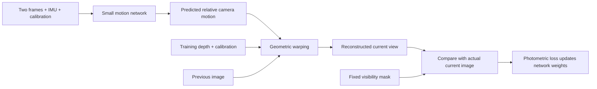

# Warping, motion estimation and world models

**Warping** reprojects an existing observation into another view. **Ego-motion
estimation** infers how the camera moved. A **world model** predicts how a world
state or future observation evolves, often conditioned on an action. The current
AeroVIO network estimates motion; geometry-based warping supplies a training
constraint. It is not a trained world/action model.

Chinese hints: warping = geometric reprojection / 几何重投影;
world model = 世界模型; ego-motion = 相机自身运动.

## A table example

Imagine a stationary table and a wall behind it. Move the camera sideways.
The table edges move across the image, usually more than the farther wall.
Perspective projection and depth explain this difference, called **parallax**.
Warping uses that geometry to locate the corresponding pixels in two views.
It does not mean bending the physical table.

If the proposed camera motion is wrong, the warped table edge will not match the
observed edge. This mismatch can train a motion predictor because the projection
and image sampler are differentiable. The model can receive a gradient telling
it how changing its estimated motion changes reconstruction error.

## The current training loop

There is also supervised relative-pose loss from training ground truth. This
implementation is therefore **supervised training with a geometric auxiliary
loss**, not a claim of fully self-supervised learning.

The warping operation is fixed camera geometry, not another neural network.
Depth comes from the simulator during training. At inference the network needs
neither reference depth nor poses, and it does not run the photometric loss.
This is why adding the loss need not increase the deployed model's computation.

## What backward warping does

For each current-image pixel, the implementation:

1. Uses its training depth and camera calibration to recover a 3D point in the
   current camera coordinates.
2. Applies the predicted current-to-previous camera transform.
3. Projects that point into the previous image.
4. Samples the previous image at that generally fractional location using
   bilinear interpolation, producing a predicted color for the current pixel.

It compares that reconstructed color with the actual current image, but only
where the fixed training-geometry visibility mask says a correspondence exists.
This is **backward warping** (从目标像素反查来源), an image-sampling convention.
It is distinct from the inverse inference problem of estimating motion from
images. We solve inverse motion inference using a known forward geometry model
inside the training loss.

Neither small photometric error nor a single image pair guarantees uniquely
correct motion: weak texture, illumination changes, repeated patterns, depth
ambiguity and occlusion can leave incorrect explanations. The pose supervision
and visibility handling constrain this pilot, but do not remove every limitation.

## Newly visible surfaces

When moving behind the table, newly visible pixels may have no match in the
previous frame. Warping cannot reconstruct their true appearance from that
frame. We exclude such pixels from the photometric comparison rather than teach
the motion model to fit unavailable colors.

A persistent map could reuse a surface observed earlier if it can associate the
new observation with that surface. The current bounded map drops lost tracks and
has no re-identification or loop closure, so that capability is not implemented.
A generative world model might predict plausible unseen content, but a plausible
prediction is not a verified observation of the actual hidden surface.

## Relationship to the original world-model idea

| Component | Question it addresses | Current AeroVIO status |
| --- | --- | --- |
| Motion estimator | Given observations, how did the camera move? | Trained small image/IMU network |
| Geometric warping | Given geometry and camera motion, how do views correspond? | Fixed training-time operation |
| Local 3D map | Which observed landmarks can constrain the current pose? | Optional bounded experimental correction |
| Action-conditioned world model | Given a state/history and action, what state or observation comes next? | Not trained or implemented |

In this static-scene project, an explicit geometric scene plus camera motion
already explains part of the observation changes. Warping is useful for testing
that explanation. A broader world model could add persistent scene memory,
occlusion reasoning, object dynamics and action-conditioned prediction; those
would be distinct experiments with their own data and validation requirements.

In the IMU-only control, the predictor receives constant image inputs. Real
training images still define the photometric supervision, so the comparison
tests **visual observations as predictor inputs**, not whether visual data had
any influence anywhere in training.

## Primary references

- Zhou et al., [Unsupervised Learning of Depth and Ego-Motion from Video,
  CVPR 2017](https://openaccess.thecvf.com/content_cvpr_2017/html/Zhou_Unsupervised_Learning_of_CVPR_2017_paper.html): view synthesis as a learning signal.
- Ha and Schmidhuber, [World Models, 2018](https://worldmodels.github.io/): learned observation/dynamics representations for control.
- [AeroVIO implementation and coordinate conventions](learned-motion.md).
